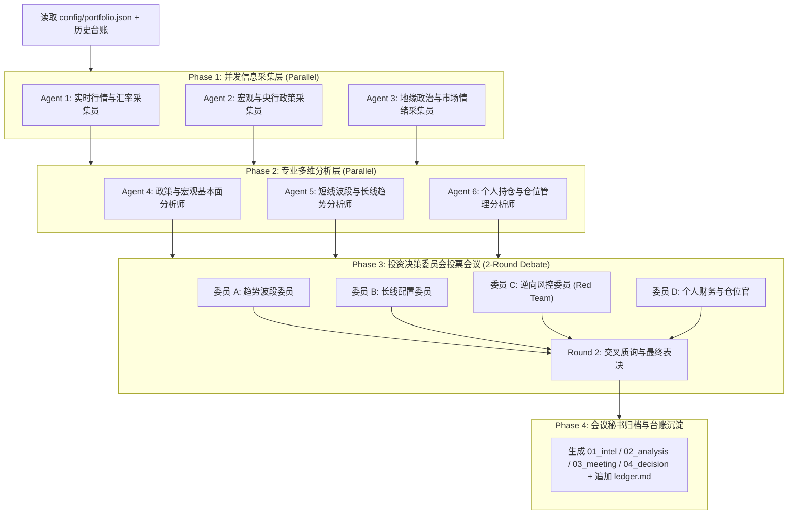

# 黄金投资多 Agent 决策 Workflow 架构文档

> 本系统为个人黄金投资研究与决策纪律辅助 Workflow，所有结论仅供决策参考，不构成持牌金融投资建议。

## 1. 核心目标与账户约束

- **账户配置文件**：`config/portfolio.json`
- **当前持仓**：本金 **7,500 RMB**，均价 **850 RMB/克**（折算持仓约 **8.8235 克**）
- **增量资金**：每月可支配投资预算 **3,000 RMB**
- **周期偏好**：**短线波段 + 长线配置双轨兼容**（既捕捉阶段性波段与止盈机会，也兼顾长期底仓配置）
- **决策动作集合**：
  - `BUY_FULL`：当月预算全额买入（最高 3,000 RMB，可分 2–3 笔执行）
  - `BUY_PARTIAL`：当月预算部分买入（如 1,000–2,000 RMB），保留现金等待回调
  - `HOLD`：维持现有仓位观望，不动用本月预算，设定明确触发价位
  - `TAKE_PROFIT_PARTIAL`：部分止盈/减仓（如减持 20%–40% 仓位锁定利润，保留长线底仓）
  - `REDUCE_HEAVY`：大幅减仓防守（如减持 50%+ 仓位，规避显著下行/利多出尽风险）

---

## 2. Multi-Agent Workflow 四阶段架构



---

## 3. 各 Agent 职责定义

### Phase 1：并发信息采集层（只输出客观事实 + 来源 + 时间）
1. **实时行情与汇率采集员**：检索最新国际现货金价（XAU/USD）、上海黄金交易所 AU9999 / 沪金 / 银行积存金人民币克价、美元指数（DXY）、美元兑人民币汇率（USD/CNY）、美债 10 年期收益率，并核对当前国内克价相对用户 850 元/克成本的实时盈亏幅度。
2. **宏观与央行政策采集员**：检索美联储利率政策与最新讲话/通胀就业数据、中国央行（PBOC）及全球央行购金动态、关税/财政赤字/货币政策核心新闻。
3. **地缘政治与市场情绪采集员**：检索近期地缘冲突/避险动态、全球及国内黄金 ETF 资金流向、市场拥挤度与近期机构主流多空观点。

### Phase 2：多维专业分析层（并行研判）
1. **政策与宏观基本面分析师**：拆解当前金价核心驱动因子（实际利率、美元汇率、央行买盘、避险溢价），区分短期噪音与中长期逻辑，给出多空催化与潜在反转点。
2. **短线波段与长线趋势分析师**：同时输出「短线 1–4 周波段视角（支撑/压力、追高与回调风险、波段止盈位）」和「长线 3–12 个月配置视角（趋势结构、情景概率）」。
3. **个人持仓与仓位管理分析师**：基于 `portfolio.json`（7,500 元本金 / 850 元均价 / 8.8235 克 / 3,000 元月预算）定量测算：
   - 当前浮动盈亏与仓位安全垫；
   - 加仓 1,000 / 1,500 / 3,000 元后的新持仓均价与风险敞口；
   - 减仓 25% / 50% 后可锁定的利润与剩余底仓成本。

### Phase 3：两轮制投资委员会投票会议
- **4 位异质角色委员**（各自保留独立多轮上下文，防观点同质化）：
  1. **趋势波段委员**：关注短线动量、波段高低点与右侧顺势/高抛机会。
  2. **长线配置委员**：关注中长期资产配置、央行购金大周期与底仓纪律。
  3. **逆向风控委员（Red Team）**：专门挑战主流做多/做空假设，评估回撤风险、汇率反噬和利多出尽；可在极端风险下标记 `risk_veto: true`。
  4. **个人财务与仓位官**：严守 3,000 元/月预算与 7,500 元现有本金约束，衡量资金效率、分批节奏与止盈保护。
- **两轮会议机制**：
  - **Round 1（独立盲评）**：4 位委员并行独立给出初评动作、建议金额/减仓比例、短/长线判断、信心分（1–10）与核心理由。
  - **Round 2（质询复议与终投）**：所有委员审阅 Round 1 全体意见（重点针对分歧与风控质疑），回应反方论点后投出最终票。
- **计票与决议规则**：
  - 按最终得票多数决定核心动作；
  - 若出现平票（如 2:2）或高分歧（4 位委员覆盖 3 种以上动作），采用保守折中方案（如 `BUY_FULL` 降级为 `BUY_PARTIAL`；买入与止盈对立则降级为 `HOLD` 并给出双边触发价）；
  - 若逆向风控委员触发 `risk_veto: true` 且最高票为 `BUY_FULL`，自动降级为 `BUY_PARTIAL` 或 `HOLD` 并高亮风控提示。

### Phase 4：文档沉淀与台账系统
每次运行会在 `records/runs/YYYY-MM-DD_HHMM/` 下自动沉淀 4 份结构化档案，并向 `records/ledger.md` 追加一条决策记录：
- `01_intel.md`：原始行情、政策、地缘与情绪情报（含来源链接/说明）
- `02_analysis.md`：政策基本面、短长线走向、个人持仓测算三份专题报告
- `03_meeting.md`：两轮投票会议完整发言记录、交锋点、投票统计表
- `04_decision.md`：一页纸最终决策单（结论、动作、具体金额/克数、短长线操作价位触发条件、核心风险）
- `raw_result.json`：完整结构化 JSON 原始快照，便于后续统计与回测复盘

---

## 4. 目录结构

```text
/Users/bytedance/Desktop/Investment/Gold/
├── config/
│   └── portfolio.json           # 个人持仓、均价、预算与偏好（调仓后更新）
├── docs/
│   ├── architecture.md          # 本架构文档
│   └── discussions.md           # 需求与策略演进讨论记录
├── workflow/
│   └── run_gold_committee.py    # 多 Agent 编排脚本
└── records/
    ├── ledger.md                # 历史决策与复盘总台账
    └── runs/
        └── YYYY-MM-DD_HHMM/     # 每次会议的完整档案包
```
