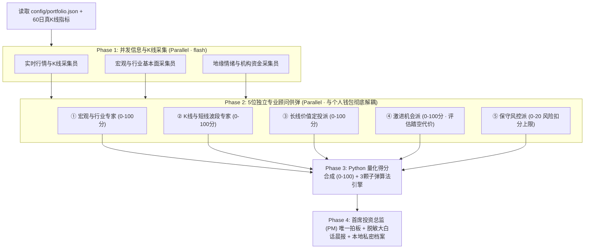

# 黄金投资多 Agent 决策 Workflow 架构文档（v3 量化多策略版）

> 本系统为个人黄金投资研究与纪律辅助 Workflow，参考顶级多策略投行/量化基金「独立因子专家组 + 动态阈值算法 + 唯一投资总监拍板」架构。所有输出仅作参考，不构成持牌金融投资建议。

## 1. 核心算法建模：每月最多 3 颗子弹 × 1,200 元

不硬卡死固定月度金额，改为 **弹性 0–3,600 元（每月最多 3 笔 × 1,200 RMB）动态阈值最优停时模型**：

| 子弹次序 | 角色定位 | 默认触发门槛（0–100 综合买点分） | 说明 |
| :--- | :--- | :---: | :--- |
| **第 1 颗子弹** | 保底建仓弹 | **≥ 65 分**（月中 15 日后仍 0 笔自动放宽至 ≥ 60 分） | 进入偏划算区间果断先打出去，杜绝死等完美底导致整月踏空 |
| **第 2 颗子弹** | 波段增强弹 | **≥ 72 分** | 捕捉当月中等回调或走强确立点 |
| **第 3 颗子弹** | 深坑机动弹 | **≥ 80 分** | 平时捏在手里不动，专留突发大跌深坑；当月无深坑则省下不花 |
| **对称止盈线** | 过热落袋 | **≤ 30 分** | 短期涨过头、K 线明显超买时提示短线卖一笔或分批止盈 |

- **跨月自动刷新**：每月 1 日自动重置当月子弹为 `0/3 颗`（2026 年 11 月已用 2/3 颗，仅剩最后 1 颗深坑弹）。
- **冷却期护栏**：相邻两笔买入原则上间隔 ≥ 2 个交易日（单日暴跌 ≥ 2% 例外）。

---

## 2. Multi-Agent Workflow 四阶段架构

---

## 3. 隐私隔离机制

- **本人专属邮件（`email.html` 与纯文本回退 `email_plain.txt`，仅发送至 `3518109978@qq.com`）**：
  - 彻底大白话（禁用 `PCE/CPI/FOMC/ETF/RSI/MA20` 等专业黑话与英文缩写）；
  - **允许并如实展示**：个人持仓均价（如 `840.31 元/克`）、现价相对均价的百分比差值、本月真实已用/剩余子弹进度，以及按实际剩余子弹做出的总监精准拍板；
  - **严格禁止展示**：持仓总金额（本金/市值）、持有克数及账面浮亏/浮盈的绝对人民币元数；
  - 展示今日客观买点综合分（0–100）、K 线位置温度计、个人 3 颗子弹状态触发灯、「🛡️ 稳健做法 vs 🔥 大胆做法」双轨选项、4 个互不重叠的白天实用价格卡、5 位专家各 1 句核心干货及 3 大风险。
- **本地完整私密档案（`records/runs/<run_id>/04_decision.md`）**：
  - 仅保存在本机（绝不作为邮件附件或纯文本正文发送），完整记录持仓总金额、克数、绝对盈亏元数及未来两周执行备忘。
